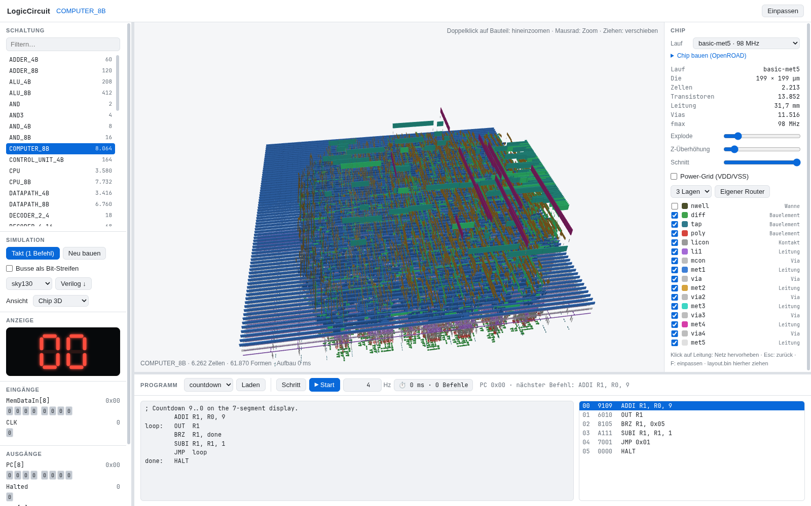

# LogicCircuit

An 8-bit computer built from NAND gates — and all the way down to a placed and
routed chip layout you can fly through in 3D.

LogicCircuit is a Rust toolkit for describing digital circuits hierarchically,
simulating and testing them, and turning them into silicon: it exports
structural Verilog, drives OpenROAD with the SkyWater 130 nm PDK, reads the
result back into its own layout format and shows it in the browser, with live
signal values from the running simulation.



*`COMPUTER_8B` placed and routed in sky130 (199 × 199 µm, 2,181 cells,
13,852 transistors, 31.7 mm of wire over five metal layers, ~98 MHz), shown in
the browser's Chip 3D view with an exploded layer stack.*

## Features

- **Circuit description language (CLDL)** – circuits are built from parts and
  connections, down to the built-in gates `NAND`, `NOT`, `AND`, `AND3`, `OR`,
  `NOR`, `NOR4`, `XOR` and `XNOR` – the cells a CMOS process offers directly.
  The simulator evaluates them in Rust ([`src/circuit/gates.rs`](src/circuit/gates.rs)).
  Each one also exists built from NAND gates only (`AND_NAND`, … in
  [`src/circuits/nand/`](src/circuits/nand)); those stand in for the gates in
  the NAND view, the NAND counts and the NAND netlist export, and
  `test --nand` runs every suite on circuits made of NAND gates alone.
- **Test language (CLT)** – every circuit ships with a test suite (`SET`,
  `EVAL`, `ASSERT`).
- **A complete 8-bit computer** – `COMPUTER_8B` = `CPU_8B` (ALU, 16 × 8
  register file, control unit, program counter) plus a two-digit hex
  7-segment display, 8,064 NANDs in total.
- **Assembler and runner** – a small 16-bit ISA (`ADD`, `SUB`, `AND`, `OR`,
  `XOR`, the `…I` immediate forms, `OUT`, `JMP`, `BRZ`, `LW`, `HALT`) with
  sample programs in [`programs/`](programs).
- **Verilog export** – structural netlists with generic cell models (for Icarus
  Verilog) or sky130 standard cells; `verify-verilog` replays all test suites
  in Icarus and checks they match the built-in simulator.
- **Chip flow** – `chip build` runs floorplan, placement, clock tree and
  routing with OpenROAD in a pinned Docker image, with a configurable number of
  metal layers, utilisation, die size, clock period and cell library (sky130
  `hd`, high density, or `hs`, high speed).
- **Own placer and router** – a simulated-annealing placer and a
  PathFinder-style maze router in pure Rust (`chip route`), no PDK needed; it
  also runs in the browser via WASM.
- **Visualisation** – a browser viewer (Rust → WASM + three.js) with views for
  parts, basic gates, NANDs, CMOS transistors and the 3D chip; CLI renders of
  the layout as SVG or PNG (top or isometric view).

## Getting started

Requires a recent Rust toolchain (edition 2024).

```bash
cargo build --release
```

Run all circuit tests:

```bash
cargo run --release -- test
```

Run a program on the computer and watch the 7-segment output:

```bash
cargo run --release -- run programs/countdown.asm --trace
```

Programs in [`programs/16/`](programs/16) run on the 16-bit `COMPUTER_16B`
(instruction set in [`ROADMAP_16BIT.md`](ROADMAP_16BIT.md)); `--input` sets
its input port:

```bash
cargo run --release -- run programs/16/factorial.asm --input 8
```

Count the NAND gates of a circuit (built-in gates counted as their NAND
definition), broken down by part, with the number of gates actually simulated:

```bash
cargo run --release -- nands COMPUTER_8B --depth 2
```

## Browser viewer

The viewer lives in [`viz/`](viz). Building the WASM bundle needs the
`wasm32-unknown-unknown` target and a matching `wasm-bindgen-cli`:

```bash
viz/build.sh
```

```bash
cargo run -p logic_circuit_viz --bin viz-serve -- 8173
```

Then open <http://localhost:8173>. Pick a circuit on the left, load and run a
program at the bottom, and switch the view in the header (the UI is in
German): *Bauteile* (parts), *Basis-Blöcke* (basic gates), *NANDs*,
*Transistoren* (CMOS) and *Chip 3D*. The header also has the clock and
rebuild buttons, the Verilog export (basic blocks or NAND gates, sky130 or
generic cells) and *Chip bauen*: a window that runs OpenROAD through
`viz-serve` (metal layers, utilisation, clock target, memory delay,
optimisation), shows the log while it builds and lists the design's layouts. In Chip 3D you can toggle layers, explode the stack, cut from the
top, click a net to highlight it through all layers, and see wires turn green
as signals go high while the program runs. The 3D view needs WebGL.

`viz/build.sh` also copies extracted chip layouts into `viz/web/layouts/`;
`chip view <NAME>` does the same for a single run and opens the browser.

## Chip flow

The OpenROAD flow runs in Docker (`openroad/orfs`, version pinned in
[`chip/flow/IMAGE`](chip/flow/IMAGE)); no Python is needed on the host.

```bash
cargo run --release -- chip build COMPUTER_8B --max-layer met5
```

```bash
cargo run --release -- chip extract COMPUTER_8B
```

`--lib hs` builds with the high-speed library `sky130_fd_sc_hs` instead of
`sky130_fd_sc_hd`: the same cells, larger and faster (SOC_16B: about +45 %
clock for +30 % area). Those runs get `-hs` in their name, e.g.
`basic-met5-hs-p5`.

```bash
cargo run --release -- chip report COMPUTER_8B
```

```bash
cargo run --release -- chip render COMPUTER_8B --iso --format png
```

```bash
cargo run --release -- chip view COMPUTER_8B
```

Or skip OpenROAD entirely and use the built-in placer and router:

```bash
cargo run --release -- chip route COMPUTER_8B --layers 3
```

Runs are stored under `chip/<NAME>/<run>/` (netlist, DEF/ODB, logs, metrics,
`layout.bin`). See [`ROADMAP.md`](ROADMAP.md) (German) for the design
decisions and the measurements from layer and mapping experiments.

## Example circuit

```text
CIRCUIT FULL_ADDER {
    INPUT a, b, cin;
    OUTPUT sum, cout;

    PART HA1: HALF_ADDER;
    PART HA2: HALF_ADDER;
    PART G_OR: OR;

    CONNECT a -> HA1.a;
    CONNECT b -> HA1.b;
    CONNECT HA1.sum -> HA2.a;
    CONNECT cin -> HA2.b;
    CONNECT HA2.sum -> sum;
    CONNECT HA1.carry -> G_OR.in1;
    CONNECT HA2.carry -> G_OR.in2;
    CONNECT G_OR.out -> cout;
}
```

Repetitive structure can be written with loops and width parameters, which
are unrolled when the definition is elaborated. A parametric circuit is
instantiated per value (`PART Sum: ADDER<16>;`, `TESTS FOR ADDER<16>`); an
indexed part `FA[i]` is named `FA_3` internally. Ranges work as in Rust:
`0..W` excludes the end, `0..=15` includes it.

```text
CIRCUIT ADDER<W> {
    INPUT A[W], B[W], Cin;
    OUTPUT S[W], Cout;

    FOR i IN 0..W {
        PART FA[i]: FULL_ADDER;
        CONNECT A[i] -> FA[i].a;
        CONNECT B[i] -> FA[i].b;
        CONNECT FA[i].sum -> S[i];
    }
    CONNECT Cin -> FA[0].cin;
    FOR i IN 1..W {
        CONNECT FA[i-1].cout -> FA[i].cin;
    }
    CONNECT FA[W-1].cout -> Cout;
}
```

## Project layout

| Path | Contents |
|---|---|
| `src/cldl`, `src/clt` | Parsers and builders for the circuit and test languages |
| `src/circuit` | Circuit model, simulator and the built-in gates |
| `src/circuits/` | Library circuits: primitives (multi-bit gates and the built-in gates' tests), `nand/` (the built-in gates from NAND gates), adders, ALU, muxes, decoders, latches, registers, display |
| `circuits/` | Larger designs: datapaths, control units, CPUs, `COMPUTER_8B` |
| `src/isa.rs`, `src/isa/`, `src/machine.rs` | Instruction sets (8- and 16-bit), assemblers, program runner |
| `src/export` | Verilog export and Icarus testbenches |
| `src/chip.rs` | `chip build` / `report` around OpenROAD |
| `src/layout` | DEF/LEF/GDS readers, `layout.bin` format, SVG/PNG renderer |
| `src/pnr` | Own placer and router |
| `chip/flow` | OpenROAD Tcl flow and Docker wrapper |
| `viz/` | WASM bindings, dev server and the browser viewer |
| `programs/` | Sample assembly programs |
